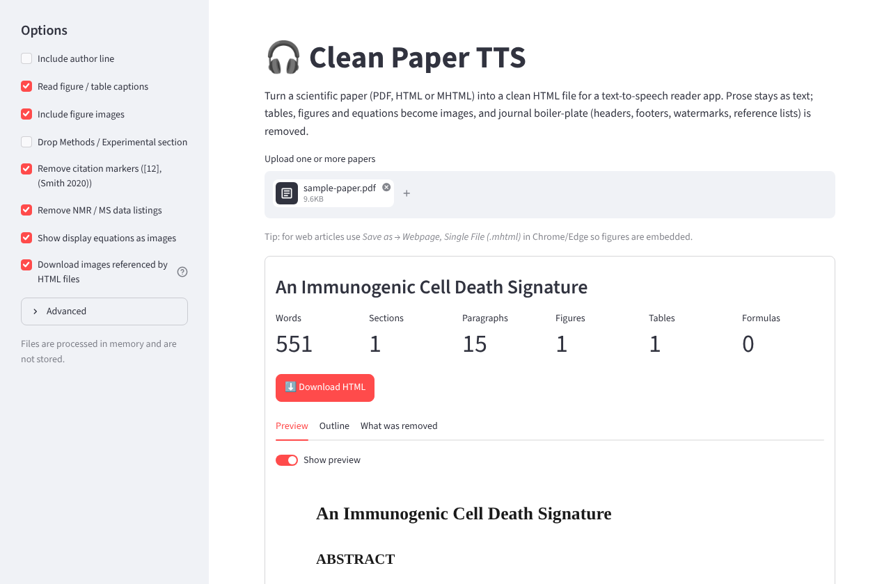
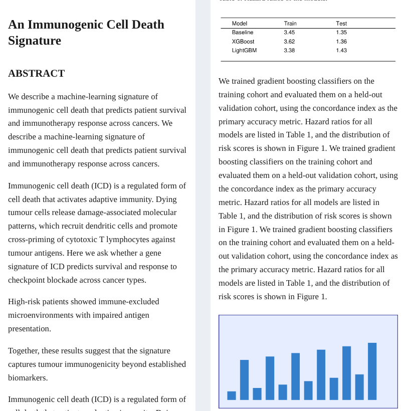
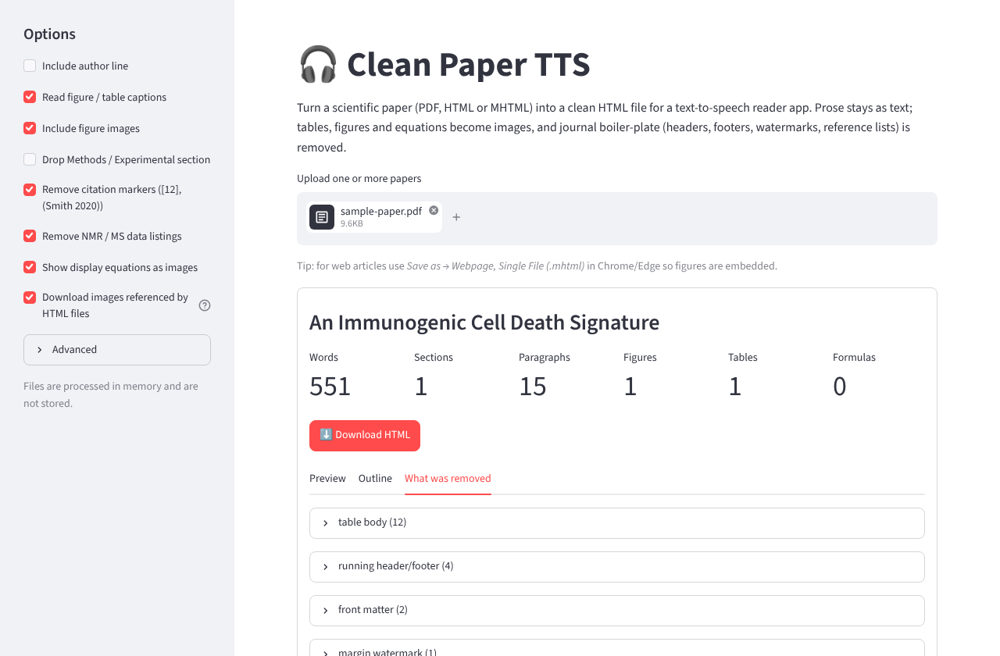
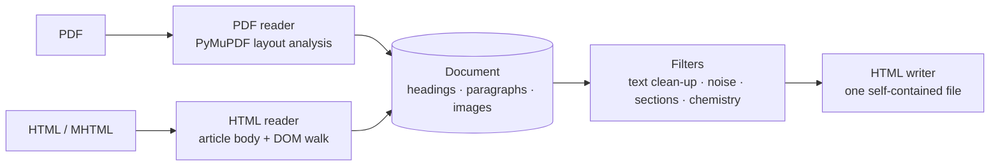

<div align="center">

# 🎧 clean-paper-tts

**Turn a scientific paper into something you can actually listen to.**

PDF · HTML · MHTML &nbsp;→&nbsp; one clean HTML file for your phone's text-to-speech reader

[](https://clean-paper-tts.streamlit.app/)
&nbsp;
[](https://github.com/pavrostiva/clean-paper-tts/actions/workflows/ci.yml)


### 👉 [clean-paper-tts.streamlit.app](https://clean-paper-tts.streamlit.app/) 👈
*Drop a file, download the HTML, open it in your reader app. Nothing is stored.*



</div>

---

## Why

Text-to-speech apps are great until you feed them a paper. They read the journal header on every page,
`Downloaded from…` watermarks, page numbers, the reference list, and then try to pronounce a results table
cell by cell: *"three point four five open bracket three point one three dash…"*

This tool keeps what you want to hear and hides the rest.

| | what happens |
|---|---|
| 📖 **Prose** | stays real text, in the right reading order (two-column layouts, hyphenated line breaks, ligatures fixed) |
| 📊 **Tables** | drawn as images, so the reader skips them. The caption stays as text |
| 🖼️ **Figures** | kept as images with silent alt text |
| ➗ **Display equations** | rendered as images (from LaTeX/MathML, or cropped from the PDF) |
| 🔢 **Citation markers** | `[12]`, `(Smith et al., 2020)`, superscript `¹²⁻¹⁴` are removed; real superscripts like `10⁶` or `Ca²⁺` are left alone |
| 🧹 **Journal junk** | running headers/footers, margin watermarks, affiliations, licence blurbs, "Cite this", page counters |
| ✂️ **Whole sections** | references, acknowledgements, author contributions, funding, supporting information, … (editable) |
| 🧪 **Chemistry** | optional: cut `¹H NMR (400 MHz, DMSO-d6) δ 8.45 (s, 1H)…` listings out of synthesis paragraphs |

Built for biology, bioinformatics and chemoinformatics papers (ACS, Wiley, Elsevier/Cell, Nature, MDPI, Frontiers,
PLOS, PMC layouts), but nothing is journal-specific by design.

<div align="center">

<br><sub>What your reader app shows: running text, then a table and a figure as images.</sub>
</div>

## Using it

### 🌐 The web app

Open **<https://clean-paper-tts.streamlit.app/>**, upload one or more files, tweak the options in the sidebar,
press *Download HTML*, then open the file in your TTS reader.

Three tabs under each result:

- **Preview**: what the page looks like.
- **Outline**: the headings that were found.
- **What was removed**: everything that was filtered out, grouped by reason (watermarks, headers, front matter,
  sections, your own regex patterns, citation markers, table text …). If something important disappeared,
  this is where you see why.

<div align="center"></div>

### Getting the best input

| Source | What to do |
|---|---|
| Publisher PDF | Works directly. Scanned PDFs (no text layer) are not supported. |
| Web article | Chrome/Edge: **Save as → Webpage, Single File (.mhtml)**. Figures get embedded. A plain `.html` also works; images are then downloaded from the page's URLs (can be switched off). |
| Preprints / PMC | PDF or MHTML both fine. |

Reader apps: anything that opens HTML (Speechify, @Voice Aloud Reader, Librera, Moon+ Reader, browser "read aloud"…).
Images have empty `alt` text on purpose, so they are skipped silently.

### 💻 Run it yourself

```bash
git clone https://github.com/pavrostiva/clean-paper-tts && cd clean-paper-tts
pip install -r requirements.txt
streamlit run app.py
```

**Command line**

```bash
python -m clean_paper_tts paper.pdf -o paper.html
python -m clean_paper_tts paper.mhtml --drop-methods --authors --report report.json
```

`--help` lists every switch.

**From Python**

```python
from clean_paper_tts import convert, Options

result = convert(open("paper.pdf", "rb").read(), "paper.pdf", Options(drop_methods=True))
open("paper.html", "w", encoding="utf-8").write(result.html)
print(result.document.stats(), result.document.warnings)
```

**Deploy your own copy:** [Streamlit Community Cloud](https://streamlit.io/cloud) → *New app* → this repo, branch `main`, file `app.py`.

## Options worth knowing

| Option | Default | Notes |
|---|---|---|
| Read figure / table captions | on | off = captions are silent too |
| Include figure images | on | off = only tables and equations stay as images |
| Drop Methods / Experimental | off | skips long reagent lists |
| Remove citation markers | on | numeric `[12]`, linked numbers, superscripts, `(Author, year)` |
| Remove NMR / MS listings | on | cuts characterisation data tails |
| Extra section titles / paragraph patterns | – | regexes, one per line, for journal-specific leftovers |

## How it works



```
clean_paper_tts/
├── readers/        input formats -> Document
│   ├── pdf/        lines -> regions (figure / table / equation) -> reading order -> paragraphs
│   ├── html.py     article-body detection, MathML / MathJax / KaTeX, tables, figures, citation links
│   └── mhtml.py    unpacks web archives and their embedded images
├── filters/        post-processing: text, noise patterns, section dropping, chemistry
├── render/         table -> PNG (Pillow), LaTeX -> PNG (matplotlib), HTML writer
├── convert.py      public entry point
└── cli.py
app.py              Streamlit UI
tests/              synthetic PDFs / HTML (no copyrighted papers)
```

<details>
<summary><b>Extending it</b></summary>

- **A journal's web layout is not recognised** → add a selector to `BODY_SELECTORS` (or a class to `NOISE_CLASS_RE`) in `readers/html.py`.
- **A recurring junk line shows up in the text** → add a regex to `NOISE_PATTERNS` in `filters/noise.py`.
- **A new kind of clean-up** → write `def my_filter(doc, options)` and append it to `FILTERS` in `filters/__init__.py`.
- **A new input format** → implement a reader that returns a `Document` and route it in `convert.py`.
- **A new option** → add it to `Options` (`options.py`) and to the sidebar in `app.py`.

</details>

<details>
<summary><b>Known limits</b></summary>

- Inline maths inside a sentence stays text (sub/superscripts are flattened: `NH32Cl2`); only display equations become images.
- Tables that continue across pages are cut at the page break.
- PDF equation detection is heuristic (centred, operator-heavy lines); unusual layouts can slip through.
- No OCR for scanned documents.

If a paper converts badly, the quickest fix is usually a new noise pattern or selector. Open an issue with the journal name
and, if you can share it, the file.

</details>

## Development

```bash
pip install -r requirements-dev.txt
pytest
```

MIT licensed.
